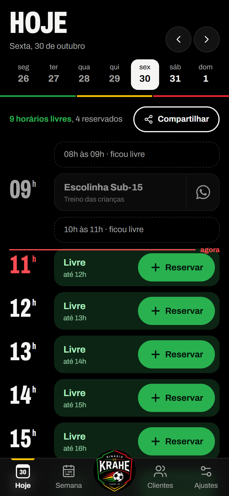
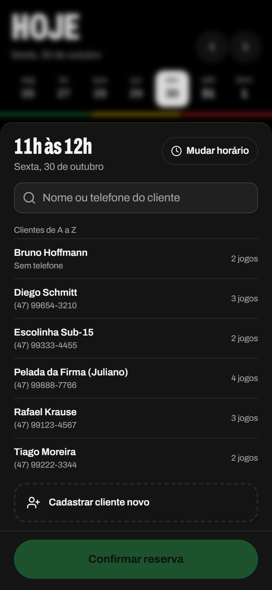
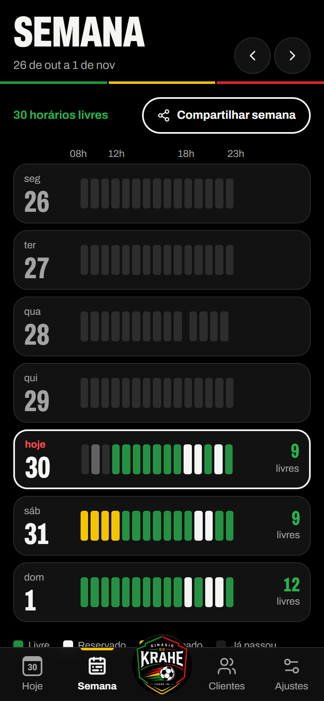
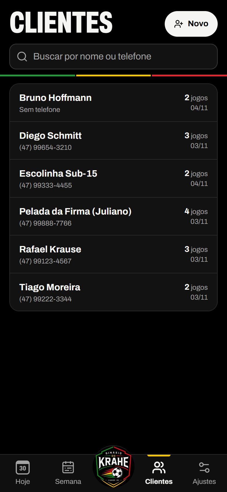
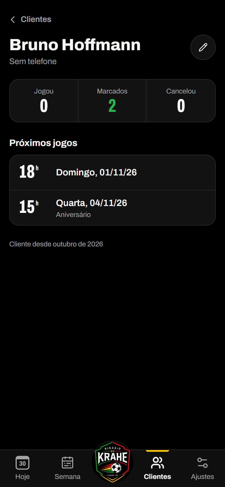
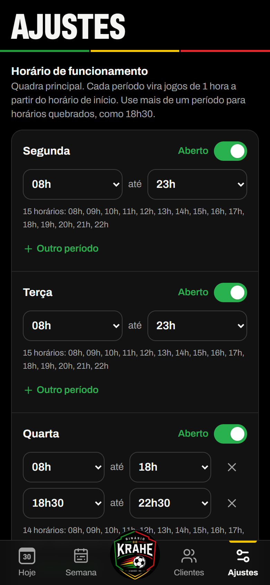

# Agenda da Quadra

Agenda de quadra de futsal feita para o **Ginásio do Krahe**, em Viamão/RS. O dono abre no celular, vê na hora o que está livre e marca o jogo com um toque, sem caderno e sem conversa perdida no WhatsApp.

O mesmo sistema é oferecido para outras quadras com o nome **De Primeira**.

**[Abrir a demonstração](https://deprimeira-demo.vercel.app)**: quadra de exemplo, sem login. Os dados voltam ao exemplo a cada hora.

<p align="center">
  
  
  
</p>

## O que ele faz

- **Hoje**: os horários do dia em ordem. Livre aparece em verde com o botão **Reservar**; ocupado mostra o cliente e um atalho para o WhatsApp dele. Uma linha vermelha marca a hora atual, e os horários que já passaram livres ficam agrupados numa linha só.
- **Reservar em três toques**: tocar no horário, escolher o cliente (busca por nome ou telefone, lista de A a Z) ou cadastrar na hora, confirmar.
- **Jogo fora da hora cheia**: dá para mudar início e fim de 30 em 30 minutos, como a escola de vôlei das 14h30 às 16h. O jogo ocupa uma linha só.
- **Horários fixos**: escolinhas e grupos que jogam toda semana no mesmo horário entram uma vez e aparecem sozinhos nas semanas seguintes.
- **Semana**: a ocupação de cada dia em barrinhas (livre, reservado, bloqueado, já passou). Tocar no dia abre a agenda dele.
- **Clientes**: busca, histórico de jogos e cancelamentos, e o botão de WhatsApp. Deslizar para a esquerda apaga, com alguns segundos para desfazer. Nome repetido (ignorando acento e maiúscula) reaproveita o cadastro que já existe.
- **Ajustes**: horário de funcionamento por dia, com mais de um período quando precisa (ex.: 08h–18h e 18h30–22h30), e bloqueios para manutenção, feriado ou evento.
- **Compartilhar horários livres**: gera o texto pronto para colar no WhatsApp, do dia ou da semana.
- **Instala como app** (PWA) na tela inicial do celular e funciona com uma mão.

<p align="center">
  
  
  
</p>

<sub>Prints com dados fictícios.</sub>

## Identidade visual

A interface veste o escudo do ginásio: fundo preto, letras brancas e as três cores do logo, cada uma com uma função.

| Cor | Onde aparece |
| --- | --- |
| Verde `#29b14f` | Horário livre e botão de reservar |
| Amarelo `#f5c400` | Bloqueios (como um cartão amarelo), foco e item ativo da navegação |
| Vermelho `#ff4d52` | Linha do "agora" e ações de cancelar ou apagar |

Os números das horas usam a Archivo no eixo de largura mais estreito, como placar de ginásio. Os títulos vêm em caixa alta, e o cabeçalho de cada tela fecha com a faixa verde, amarela e vermelha do escudo. O sistema completo de cores, tipografia e componentes está em [DESIGN.md](./DESIGN.md).

## Tecnologia

| Camada | Escolha |
| --- | --- |
| App | Next.js 16 (App Router, Server Actions, Cache Components) + React 19 + TypeScript |
| Interface | Tailwind CSS v4 + shadcn/ui, mobile first (testado em 375px) |
| Banco | PostgreSQL no Supabase, com Drizzle ORM e migrations versionadas |
| Login | Supabase Auth (e-mail e senha, sem cadastro aberto) |
| Datas | date-fns + date-fns-tz: tudo salvo em UTC, exibido em `America/Sao_Paulo` |
| Testes | Vitest, incluindo testes das regras do banco com PGlite |
| Deploy | Vercel (região São Paulo), com cron para resetar a demonstração |

### Arquitetura

Monólito modular, um módulo por domínio. Novas áreas do ginásio (financeiro, bar, mensalistas) entram como módulos novos sem mexer nos existentes.

```
src/
  app/                 rotas (Hoje, Semana, Clientes, Ajustes, Entrar)
  modules/
    agenda/            horários, reservas, fixos, bloqueios, compartilhar
    clientes/          cadastro, busca, repetidos
    configuracoes/     funcionamento da quadra
    demo/              dados de exemplo e reset da demonstração
  db/                  schema Drizzle e migrations
  lib/                 datas, telefone, utilidades
  components/          navegação e componentes de interface
```

### Regras garantidas pelo banco

- **Nunca duas reservas no mesmo horário**: exclusion constraint com `btree_gist` sobre `tstzrange(inicio, fim)` por quadra, ignorando canceladas. Vale mesmo com dois cliques ao mesmo tempo.
- Os horários livres **não são gravados**: são calculados a partir do funcionamento, menos reservas confirmadas e bloqueios.
- Fixos semanais geram as reservas até cerca de 12 semanas à frente e conforme a agenda é aberta.
- RLS ligado em todas as tabelas, sem policies: o app só fala com o banco pelo servidor, e a API pública do Supabase não lê nada.

### Modelo de dados

`quadras`, `clientes`, `reservas`, `reservas_fixas`, `horarios_funcionamento`, `bloqueios` e `usuarios` (com papel `dono` ou `funcionario`, já pronto para funcionários).

## Rodar localmente

Não precisa de Supabase para desenvolver: o projeto traz um Postgres embutido (PGlite).

```bash
npm install
npm run db:local        # terminal 1: Postgres local na porta 5433
npm run db:migrate      # terminal 2
npm run db:seed         # 1 quadra, aberta 08h–23h todos os dias
npm run db:exemplo      # opcional: clientes e reservas fictícios
npm run dev
```

Copie o `.env.example` para `.env.local` e use as linhas de desenvolvimento local. `AUTH_DESATIVADA=1` pula o login e é ignorado em produção.

### Ligar no Supabase

1. Crie o projeto no [Supabase](https://supabase.com), região **South America (São Paulo)**.
2. Preencha o `.env.local` com os valores do projeto e **remova** `AUTH_DESATIVADA`.
3. Em **Authentication → Sign In / Providers**, desligue *Allow new users to sign up*.
4. Em **Authentication → Users → Add user**, crie o usuário do dono.
5. Rode `npm run db:migrate` e `npm run db:seed`.
6. Entre com o e-mail do dono. O primeiro usuário vira **dono**; os seguintes, **funcionário**.

### Demonstração

A demonstração é outro deploy, com outro banco (Neon) e `NEXT_PUBLIC_MODO_DEMO=1`, que desliga o login e troca o nome para De Primeira. Os scripts recusam rodar contra o banco do Supabase.

```bash
npm run demo:preparar   # migrations + dados de exemplo no banco da demo (.env.demo)
npm run demo:resetar    # volta os dados ao exemplo
```

## Scripts

| Script | O que faz |
| --- | --- |
| `npm run dev` | Servidor de desenvolvimento |
| `npm test` | Testes (horários, recorrência, telefone, texto do WhatsApp, nomes repetidos e regras do banco) |
| `npm run db:generate` | Gera migration a partir de `src/db/schema.ts` |
| `npm run db:migrate` | Aplica as migrations |
| `npm run db:seed` | Cria a quadra e o horário de funcionamento (idempotente) |
| `npm run db:studio` | Drizzle Studio |
| `npm run db:local` | Postgres local (PGlite) para desenvolver sem Supabase |
| `npm run db:exemplo` | Dados fictícios (só roda contra o banco local) |
| `npm run demo:preparar` / `demo:resetar` | Banco da demonstração |

## Próximos passos

Preço por horário, controle de pagamento, mensalidade dos fixos, permissões de funcionário, página pública para o cliente pedir horário e mais de uma quadra.
